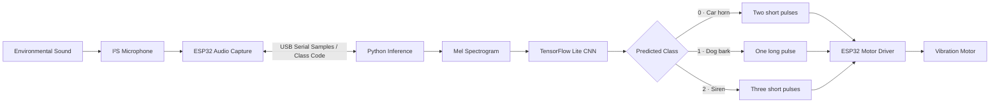
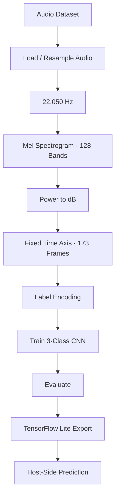

<div align="center">

# 🔔 Alert-to-Vibration Assistive System
### ESP32 · I²S Audio · CNN Sound Classification · TensorFlow Lite · Haptic Alerts

**HEAR THE ALERT. FEEL THE NOTIFICATION.**

An assistive embedded-AI prototype that classifies three environmental sounds and converts the detected class into a distinct vibration pattern.

[](https://www.espressif.com/en/products/socs/esp32)
[](https://www.tensorflow.org/)
[](https://www.tensorflow.org/lite)
[](https://www.python.org/)
[](https://www.arduino.cc/)

### ⚡ Try the interactive system demo

**[▶ Open the interactive sound-to-vibration demo](demo/index.html)**

Select **Car Horn**, **Dog Bark**, or **Siren** to illuminate its path through the system and preview the corresponding vibration signal.

</div>

---

## 🎯 Project overview

This project explores a tactile alert interface for people who may not reliably hear selected environmental sounds. It combines an ESP32-based audio acquisition stage, a host-side CNN sound classifier, serial communication, and a vibration motor.

### 🔊 Supported sound classes

| Sound class | Icon | Output pattern in supplied firmware |
|---|---:|---|
| Car horn | 🚗 | Two short pulses |
| Dog bark | 🐕 | One longer pulse |
| Siren | 🚨 | Three short pulses |

## ✨ Interactive system walkthrough

Open the [interactive demo](demo/index.html), then choose one of the three sound classes. The animation highlights the corresponding detection-to-output path and displays the vibration pulse pattern represented by the supplied ESP32 sketch.

> The demo is a documentation/portfolio visualization. It simulates the signal path in a browser; it does not connect to the physical ESP32, run the CNN model, or actuate a real motor.

## 🧠 How the system works

1. **Audio capture:** An I²S digital microphone supplies audio samples to the ESP32.
2. **Serial transfer:** The ESP32 streams sample values to the connected computer over USB serial.
3. **Feature extraction:** The Python inference workflow prepares a Mel spectrogram using the model's expected preprocessing.
4. **Sound classification:** A TensorFlow Lite CNN predicts one of the three supported classes.
5. **Prediction feedback:** Python sends a one-character class code (`0`, `1`, or `2`) to the ESP32.
6. **Tactile notification:** The ESP32 drives the vibration motor with the class-specific pulse sequence.

## 🧩 System architecture



**Implementation note:** In the supplied working flow, CNN inference runs on the connected computer. The ESP32 handles microphone acquisition and vibration control; the model is not currently executed on the ESP32 itself.

## 🧪 Machine-learning pipeline

The supplied training notebook uses a three-class audio dataset and a CNN classification pipeline.



## 🛠️ Hardware

The supplied ESP32 firmware defines the following GPIO assignments:

| Signal | ESP32 GPIO |
|---|---:|
| I²S word select (WS) | 25 |
| I²S serial data (SD) | 33 |
| I²S serial clock (SCK) | 26 |
| Vibration motor control | 14 |

Hardware used or implied by the source:

- ESP32 development board
- I²S-compatible digital microphone
- Vibration motor
- Suitable transistor/MOSFET motor driver and protection components
- Appropriate power supply and connecting wires

**Electrical safety:** Do not drive a vibration motor directly from an ESP32 GPIO. Use a suitable driver stage and a supply rated for the motor. Confirm the microphone pinout and voltage requirements for your exact modules.

## 🔢 Class codes and vibration patterns

The supplied firmware expects a single character from the host application:

| Serial code | Class | Firmware output |
|---:|---|---|
| `0` | `car_horn` | ON 200 ms → OFF 200 ms → ON 200 ms → OFF |
| `1` | `dog_bark` | ON 400 ms → OFF |
| `2` | `siren` | Three cycles of ON 150 ms → OFF 150 ms |

The label encoder artifacts included in the prepared package should be checked against the model output order before changing or retraining the classifier. The class-code mapping above is taken from the supplied ESP32 sketch.

## 📊 Model configuration

| Parameter | Value in supplied training workflow |
|---|---:|
| Number of classes | 3 |
| Classes | Car horn, Dog bark, Siren |
| Audio sample rate | 22,050 Hz |
| Feature representation | Mel spectrogram |
| Mel bands | 128 |
| Fixed time dimension | 173 frames |
| Model format | TensorFlow Lite |

The original training notebook reports an optimized CNN accuracy of **94.19%** in a comparison table. This is a notebook-reported result, not an independently reproduced benchmark or a guarantee of real-world performance. Re-evaluate with a representative held-out dataset before using this figure as a validated performance claim.

## 📁 Repository structure

```text
alert-to-vibration-system/
├── demo/
│   └── index.html
├── firmware/
│   └── alert_vibration_esp32.ino
├── models/
│   ├── cnn_model_retrain_optimized.tflite
│   └── label_encoder*.pkl
├── notebooks/
│   ├── train_3class_alert.ipynb
│   ├── serial_inference_final.ipynb
│   ├── serial_inference_with_confidence.ipynb
│   └── manual_audio_prediction.ipynb
├── .gitignore
├── requirements.txt
├── SECURITY_REVIEW.md
└── README.md
```

Large raw audio collections, duplicate training artifacts, notebook checkpoints, and generated videos are intentionally excluded from this portfolio package.

## 🚀 Getting started

### 1. Clone the repository

```bash
git clone https://github.com/<YOUR_GITHUB_USERNAME>/alert-to-vibration-system.git
cd alert-to-vibration-system
```

### 2. Create a Python environment

Python 3.10 or 3.11 is a sensible starting point for the TensorFlow and Librosa stack.

```bash
python -m venv .venv
```

Activate it:

**Windows PowerShell**
```powershell
.venv\Scripts\Activate.ps1
```

**Linux / WSL**
```bash
source .venv/bin/activate
```

Install dependencies:

```bash
pip install -r requirements.txt
```

### 3. Prepare the ESP32

1. Open `firmware/alert_vibration_esp32.ino` in Arduino IDE.
2. Select the correct ESP32 board and serial port.
3. Verify the I²S microphone wiring against the GPIO definitions.
4. Connect the vibration motor through a suitable driver circuit.
5. Upload the sketch and open Serial Monitor at **115200 baud**.

### 4. Run host-side inference

1. Open `notebooks/serial_inference_final.ipynb`.
2. Update the serial port (the supplied notebook uses `COM4` as an example).
3. Confirm the model and label encoder paths point to files in `models/`.
4. Run the notebook while the ESP32 is connected.

For offline testing, open `notebooks/manual_audio_prediction.ipynb` and provide a local audio-file path.

## 🔐 Safety, privacy and responsible use

- Do not commit private recordings or datasets unless you have permission to publish them.
- Review notebook outputs before committing; outputs can contain local paths or sensitive information.
- Keep credentials and local configuration out of Git.
- Use a suitable motor driver and power supply; do not connect the motor directly to a GPIO.
- This is an academic prototype, not a certified assistive or emergency-warning device. It must not be relied on as the sole means of receiving safety-critical alerts.

See [`SECURITY_REVIEW.md`](SECURITY_REVIEW.md) for package-specific cleanup notes.

## ⚠️ Known limitations

- Model inference runs on the connected computer in the supplied workflow, rather than directly on the ESP32.
- Firmware streams integer samples as serial text, which can limit throughput and timing accuracy.
- The Python inference workflow assumes a specific sample count and preprocessing pipeline; live audio must match the model's training conditions.
- The ESP32 sends a sample buffer before checking for a returned prediction; end-to-end latency should be measured.
- Motor patterns use blocking `delay()` calls.
- The model's reported accuracy has not been independently verified against new real-world recordings.

## 🛣️ Future improvements

- Move feature extraction and inference to an embedded-capable runtime if standalone operation is required.
- Replace text-based sample streaming with a more efficient binary serial protocol.
- Add robust message framing, acknowledgements, and timeouts.
- Add confidence thresholds and an unknown/no-alert class.
- Measure end-to-end latency, missed detections, and false alarms in realistic environments.
- Develop a wearable enclosure, battery management, and configurable vibration patterns.

## 👨‍💻 Author

**Kousik Jayanthi**  
Electronics and Communication Engineering  
**Interests:** Embedded Systems · Audio Signal Processing · Machine Learning · Assistive Technology

---

<div align="center">

**Turning selected environmental sounds into tactile notifications.**

⭐ If this project interests you, consider starring the repository.

</div>
